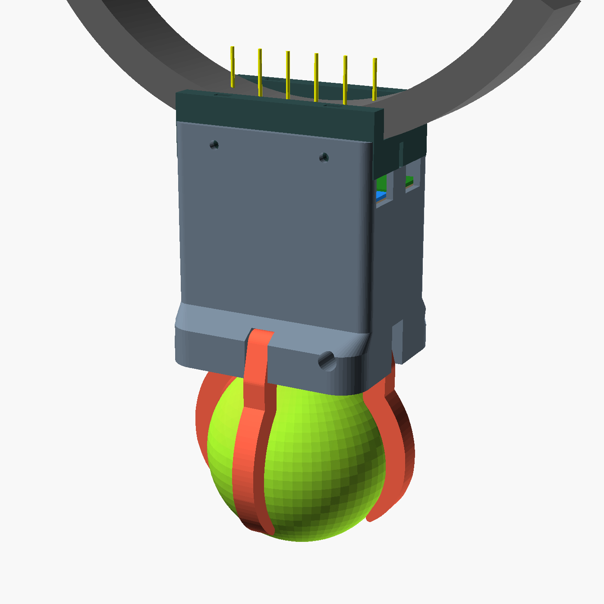
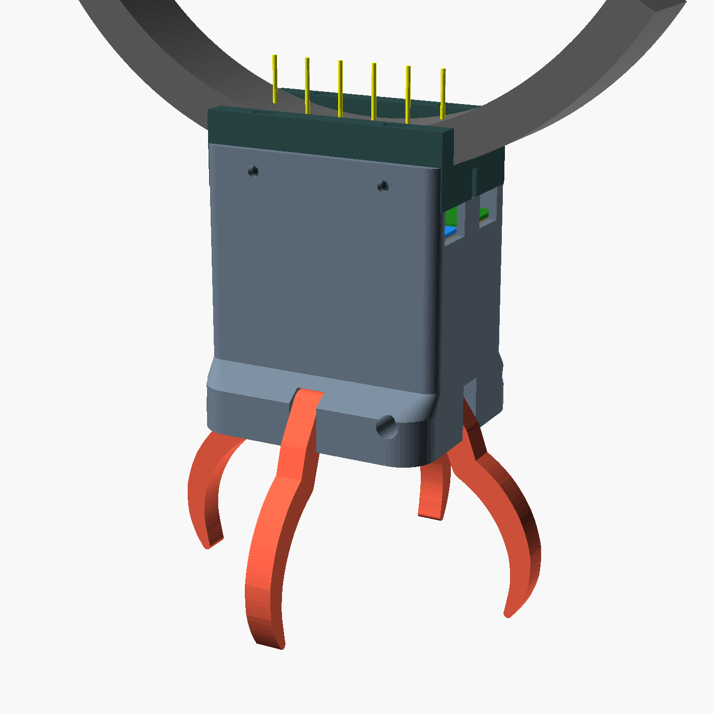
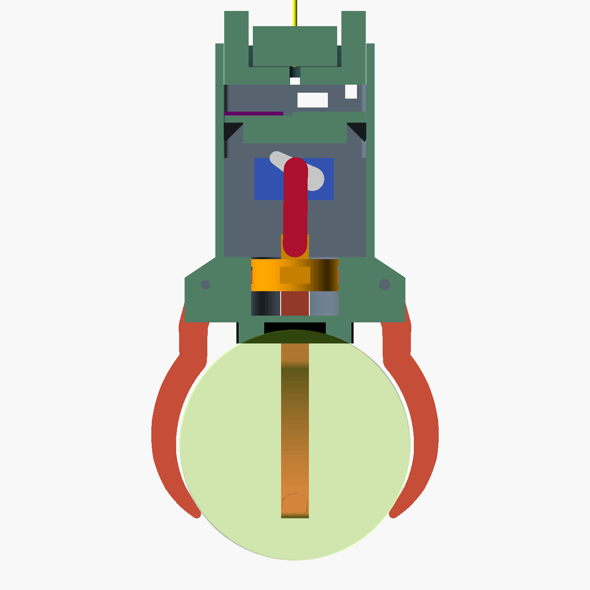
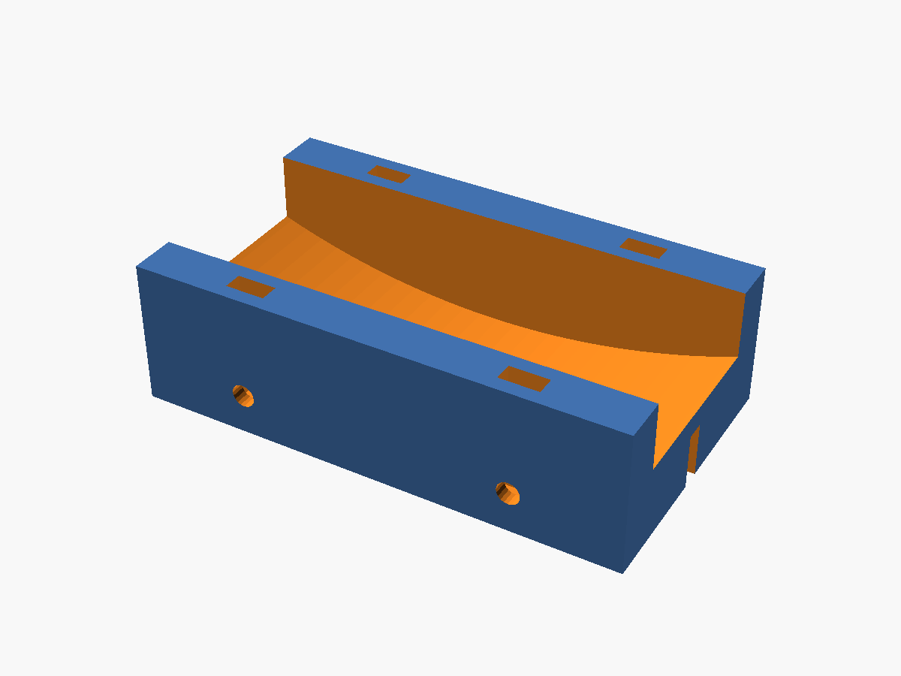

# Bauplan: Ballgreifer für die Tennisschläger-Spitze (Entwurf v0.1)

Ein 4‑Finger‑Greifer („Kralle“), der an der Schlägerspitze mit eingespannt wird.
Schläger auf den Ball drücken, Taster drücken: Greifer schließt. Nochmal drücken: Greifer öffnet.

> **Stand:** erster Entwurf. Die Schlägermaße sind Näherungswerte für einen Wilson Clash 100.
> Den **Sattel erst drucken, wenn die echten Maße eingetragen sind** (siehe Abschnitt 7).
> Das Modell ist am Rechner auf Kollisionen geprüft, aber noch nicht gebaut und getestet.

| Geschlossen | Offen | Schnitt |
|---|---|---|
|  |  |  |

## 1. So funktioniert es

```
   Rahmen (Schlägerspitze)
  ══════════════════════════
  │  Sattel  │  ← wird mit den Saiten festgespannt
  ├──────────┤
  │ Elektronik│  ← Pico, Lademodul, Step-Up, darunter der Akku
  │  Servo ◯─┐│  ← Servohorn
  │          ││  ← Koppelstange
  ├───┬────┬─┘┤
  │ ●─┤Schie├─● │ ← Schieber fährt 5,6 mm hoch/runter, ● = Fingergelenk
  └─┼─┤ ber ├─┼─┘
    │ └─────┘ │
    │ Anschlag│   ← Ball stößt hier an (Kraft geht in den Rahmen, nicht in den Servo)
    (  Ball   )
     `─┘   └─´    ← Fingerspitzen greifen 30° unter die Ballmitte
```

- **Antrieb:** Der Servo zieht über eine Koppelstange einen Schieber nach oben. Jeder der vier Finger hat innen einen kurzen Hebel mit einer runden Nase, die in einem Schlitz des Schiebers sitzt. Schieber hoch = alle vier Finger schließen gleichzeitig.
- **Halten durch Form:** Geschlossen liegen die Fingerspitzen auf einem Kreis von 58 mm Durchmesser unterhalb der Ballmitte. Der Ball (67 mm) kann nicht herausfallen, auch wenn der Servo kaum Kraft aufbringt.
- **Offen:** ca. 100 mm lichte Weite, man muss den Ball also nicht genau treffen.
- **Kraft (rechnerisch, bei 5 V):** ca. 2 N pro Fingerspitze. Der Ball wiegt 0,57 N.

### Eckdaten

| | |
|---|---|
| Gehäuse | 72 × 46 mm (unten 64 mm breit), 81 mm hoch |
| Überstand über die Schlägerspitze | ca. 130 mm bis zu den Fingerspitzen |
| Fingerschwenk | 20°, Servoweg dafür ca. 60° |
| Zusatzgewicht an der Spitze | ca. 180 g (Schätzung) |

## 2. Befestigung am Schläger

Der **Sattel** sitzt außen auf der Rahmenspitze, über dem Kopfschutzband. Er hat 6 Löcher, die zu den 6 mittleren Saitenlöchern passen. Beim Bespannen führst du die Längssaiten durch Sattel **und** Rahmen. Die Saitenschlaufen liegen außen in einer Nut des Sattels und ziehen ihn fest auf den Rahmen. Bei 6 Löchern sind das 3 Schlaufen.



- Das Gehäuse wird danach von außen über den Sattel gestülpt und mit 4 Schrauben M3×8 seitlich verschraubt. Es lässt sich also jederzeit abnehmen, ohne die Bespannung zu öffnen.
- **Bespannungshärte:** niedrig wählen, 10–15 kg reichen. Lochkanten am Sattel vorher entgraten, damit die Saite nicht scheuert.
- Zwischen Sattel und Rahmen 1–2 mm Moosgummi legen, das gleicht Formabweichungen aus.

## 3. Druckteile

Material: **PETG** für alles (zäh, bricht nicht spröde, verträgt Saitenzug und Sonne besser als PLA). Wenn du TPU hast: Anschlagring daraus drucken, dann rutscht der Ball weniger.
Einstellungen: Düse 0,4 mm, Schicht 0,2 mm. Keine Stützen nötig. Jeder Drucker ab 120 × 120 mm Bauraum reicht.

| Teil | Datei | Stück | Lage auf dem Druckbett | Füllung |
|---|---|---|---|---|
| Sattel | `stl/sattel.stl` | 1 | Flachseite unten | 100 % |
| Gehäuse mit Greiferbasis | `stl/gehaeuse.stl` | 1 | Basis unten | 4 Wände, 25 % |
| Kralle (Finger) | `stl/kralle.stl` | 4 | flach liegend | 5 Wände, 60 % |
| Schieber | `stl/spule.stl` | 1 | Lasche oben | 100 % |
| Koppelstange | `stl/koppel.stl` | 1 | flach | 100 % |
| Anschlagring | `stl/anschlag.stl` | 1 | Flachseite unten | 100 % |
| Elektronikträger | `stl/deck.stl` | 1 | flach | 100 % |
| Tasterhalter | `stl/taster.stl` | 1 | Wölbung unten | 50 % |

Die Dateien liegen schon in Drucklage. Alle Maße stehen als Parameter oben in `cad/greifer.scad` (kostenloses Programm OpenSCAD). `cad/export.sh` erzeugt STL und Bilder neu.

## 4. Einkaufsliste

Preise sind Richtwerte aus dem Gedächtnis, bitte beim Bestellen prüfen (z. B. Berrybase, Reichelt, Amazon).

| # | Bauteil | Stück | ca. € |
|---|---|---|---|
| 1 | Raspberry Pi **Pico** (ohne Stiftleisten) | 1 | 5 |
| 2 | Micro‑Servo **MG90S** (Metallgetriebe, 180°) | 2 (1 Ersatz) | 8 |
| 3 | LiPo‑Akku 1S 3,7 V, 500–600 mAh, **mit Schutzschaltung**, max. 36 × 30 × 6 mm (Typ 503035) | 1 | 7 |
| 4 | Lademodul **TP4056 mit USB‑C und Schutzschaltung** | 1 | 2 |
| 5 | **5‑V‑Step‑Up‑Wandler**, Festspannung, mind. 1 A (z. B. Pololu U3V12F5) | 1 | 5 |
| 6 | Mini‑Schiebeschalter (Typ SS12D00) | 1 | 1 |
| 7 | Drucktaster 12 × 12 mm mit Kappe | 1 | 1 |
| 8 | Elko 470 µF, mind. 10 V | 1 | 0,50 |
| 9 | Litze 2‑adrig, ca. 1 m (Tasterkabel) + dünne Schaltlitze | | 3 |
| 10 | Schrauben: 4× M3×25, 4× M3×8, 4× M3‑Mutter, 2× M2×8 (am günstigsten als Sortiment M2/M3) | | 8 |
| 11 | Kabelbinder 2,5 mm | 10 | 2 |
| 12 | Schrumpfschlauch Ø 6–8 mm (Fingerspitzen), Moosgummi 2 mm, doppelseitiges Klebeband | | 3 |
| 13 | PETG‑Filament, ca. 150 g | | 4 |
| | **Summe** | | **ca. 50** |

Dazu: Micro‑USB‑Kabel (Programmieren), USB‑C‑Kabel (Laden), Lötkolben, kleiner Kreuzschlitz und Inbus.

Warum diese Teile:
- **Pico statt „großem“ Pi:** sofort an, 3 g, braucht kaum Strom, 5 €.
- **MG90S statt SG90:** Metallgetriebe, überlebt auch ein Verklemmen.
- **Step‑Up auf 5 V:** der Servo läuft so mit voller Kraft, egal wie voll der Akku ist. Billige Alternative ist der einstellbare MT3608 (ca. 1,50 €); den musst du **vor dem Anschließen mit einem Multimeter auf 5,0 V drehen**, sonst zerstört er Servo und Pico.
- Keine Powerbank‑Platinen (IP5306 o. ä.) nehmen: die schalten bei kleinem Strom von selbst ab.

## 5. Verdrahtung

```
LiPo +  ─► TP4056 B+          TP4056 OUT+ ─► Schiebeschalter ─► Step-Up IN+
LiPo −  ─► TP4056 B−          TP4056 OUT− ───────────────────► Step-Up IN−

Step-Up OUT+ (5 V) ─┬─► Servo rot
                    ├─► Pico VSYS (Pin 39)
                    └─► Elko +
Step-Up OUT− (GND) ─┬─► Servo braun
                    ├─► Pico GND (Pin 38)
                    └─► Elko −  (Streifen am Elko = Minus)

Pico GP15 (Pin 20) ─► Servo orange (Signal)
Pico GP14 (Pin 19) ─► Taster ─► Pico GND (Pin 18)
```

- Beim Programmieren über USB den Schiebeschalter auf **Aus** stellen.
- LiPo nie kurzschließen, nicht unbeaufsichtigt laden, nicht anstechen.

## 6. Zusammenbau

1. **Programm aufspielen:** MicroPython auf den Pico (Thonny), dann `firmware/main.py` als `main.py` speichern.
2. **Elektronik** nach Abschnitt 5 verlöten. Pico, Lademodul und Step‑Up mit Klebeband oben auf den Elektronikträger kleben (USB‑Buchsen zeigen zur selben Schmalseite), Akku auf die Unterseite.
3. **Servo vorbereiten:** einschalten (fährt auf „offen“). Servohorn so aufstecken, dass es etwa 30° von der Waagerechten zum Schieber hin zeigt, festschrauben. Horn hinter dem genutzten Loch (ca. 5,5 mm von der Achse) abschneiden.
4. **Antrieb vormontieren (außerhalb des Gehäuses):** Koppelstange mit je einer M2×8 an Servohorn und Schieber‑Lasche schrauben. Die Schrauben schneiden sich ihr Gewinde selbst, nur so fest, dass sich alles leicht dreht.
5. Kabelbinder durch den Schlitz im Servobett fädeln. Dann Servo samt Schieber von oben einsetzen: Servolaschen in die Nuten, Schieber in die runde Tasche. Kabelbinder schließen.
6. **Finger einsetzen:** jeden Finger von außen in seinen Schlitz schieben, bis die Nase im Schieber sitzt. M3×25 durch den seitlichen Kanal eindrehen. Nur anlegen, nicht festziehen, der Finger muss frei schwingen.
7. Anschlagring unten aufkleben. Schrumpfschlauch auf die Fingerspitzen.
8. Elektronikträger auf die vier Auflagen legen, Schalter in die Wandöffnung kleben, Tasterkabel durch die Kerbe führen, ein Stück Schaumstoff obenauf.
9. **Schläger bespannen** mit Sattel (Abschnitt 2), M3‑Muttern in die Taschen des Sattels stecken.
10. Gehäuse aufstecken, 4× M3×8 seitlich eindrehen. Tasterhalter am Griff mit Kabelbindern befestigen, Kabel am Rahmen entlang mit Kabelbindern.
11. **Einstellen:** in `main.py` `WINKEL_AUF` und `WINKEL_ZU` in 5°‑Schritten anpassen, bis der Greifer den Ball sicher hält. Wenn der Servo im geschlossenen Zustand brummt, `WINKEL_ZU` ein paar Grad zurücknehmen. Läuft er falsch herum, die beiden Werte tauschen.

## 7. Was ich noch von dir brauche

Diese Werte sind im Modell geschätzt und müssen am echten Schläger gemessen werden:

| Maß | Parameter | Annahme |
|---|---|---|
| Rahmenhöhe an der Spitze, quer zur Saitenebene, **mit** Kopfschutzband | `frame_beam` + `bumper_extra` | 24,5 + 2,5 = 27 mm |
| Abstand der 6 mittleren Saitenlöcher an der Spitze (Mitte zu Mitte) | `string_pitch` | 10,5 mm |
| Krümmung der Spitze | `tip_R` | Radius 105 mm |

Für die Krümmung am einfachsten: Schläger flach auf ein Blatt Papier legen, die Außenkontur der Spitze nachzeichnen und ein Foto mit Lineal schicken.

## 8. Offene Punkte dieses Entwurfs

- **Optik:** Die Finger sind schon krallenförmig, das Gehäuse ist noch ein schlichter Kasten. Die Kralle/Blüte‑Form kommt im nächsten Schritt, wenn die Mechanik feststeht.
- **Passungen** (0,2–0,3 mm Spiel) hängen vom Drucker ab und müssen evtl. nachgestellt werden.
- Die Fächer für die Platinen sind bewusst allgemein gehalten, weil die Modulgrößen je nach Händler abweichen.
